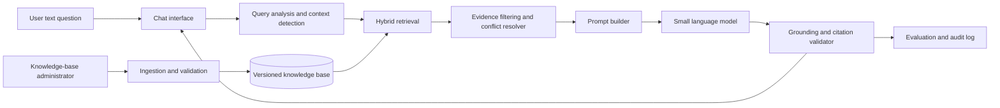

# Mid-Semester System Architecture

## Edge AI-Based Smart Campus Information Robot Using SLMs

## 1. Architecture objective

The mid-semester system is a text-based, evidence-grounded campus assistant.
It separates document authority and retrieval from language generation so that
the SLM explains verified campus information instead of acting as an
unrestricted chatbot.



## 2. Components

### 2.1 Chat interface

Responsibilities:

- accept a typed question;
- display the answer and source citation;
- show clarification questions;
- show uncertainty or conflicting-source notices; and
- avoid displaying internal prompts or raw sensitive metadata.

The interface may initially be a lightweight local web application.

### 2.2 Query analysis and context detection

This component identifies:

- intent, such as attendance, residence, examination, course, fee, contact or
  facility;
- user type;
- programme or school;
- residence status;
- academic year;
- exact entities, numbers, timings and names.

It should use deterministic matching for programme names and years before
invoking an LLM-based classifier. If the context is required but absent, it
should ask a clarification question.

### 2.3 Ingestion and validation

The ingestion pipeline shall:

1. load a source file;
2. remove repeated headers, footers and extraction artefacts;
3. identify headings and numbered sections;
4. preserve tables as structured records where possible;
5. split prose into semantically coherent chunks;
6. attach source metadata;
7. generate embeddings; and
8. run validation checks for missing metadata and duplicate chunks.

The original files must remain unchanged and be retained as the audit source.

### 2.4 Versioned knowledge base

Use two complementary stores:

#### Structured store

Recommended entities:

```text
documents
sections
chunks
contacts
services
timings
programmes
courses
policies
evaluation_questions
```

#### Vector index

The vector index stores an embedding for each chunk and returns:

```text
chunk_id
similarity_score
document_id
text
metadata
```

Exact values such as `75%`, `₹500`, `10:00 PM`, course credits, and phone
numbers should be searchable through the structured store or keyword index in
addition to semantic retrieval.

### 2.5 Hybrid retrieval

For each question:

1. Normalize spelling, punctuation and programme aliases.
2. Extract exact entities and numeric constraints.
3. Apply scope filters where context is known.
4. Run keyword/exact retrieval.
5. Run vector retrieval.
6. Merge and rerank results.
7. Prefer current applicable sources.
8. Pass only the top evidence set to the prompt builder.

The retriever should not retrieve a 2020 XCOMM examination rule as the default
answer to a current university-wide UG examination question.

### 2.6 Evidence filtering and conflict resolution

Every retrieved passage should be checked for:

- relevance to the question;
- applicable student group;
- school or programme;
- academic-year validity;
- effective date;
- source priority;
- contradiction with another selected passage.

If two sources conflict, the component should pass a labelled comparison to the
answer generator rather than silently concatenating both rules.

### 2.7 Prompt builder

The prompt should contain:

```text
System instructions
User question
Detected context
Retrieved evidence with source labels
Answer format
Uncertainty and citation rules
```

Required generation rules:

- answer only from the supplied evidence;
- do not invent missing facts;
- distinguish current and historical policies;
- state when programme or academic year changes the answer;
- cite the document and section;
- recommend an authority for unresolved cases.

### 2.8 Small language model

The SLM is responsible for:

- synthesising retrieved passages;
- explaining policy language;
- asking for missing context; and
- formatting the answer.

It is not responsible for deciding which policy is current. That decision
belongs to metadata filtering and conflict resolution.

The team should benchmark at least two suitable lightweight models using the
same test set and report model size, quantisation, memory use, latency, and
answer quality.

### 2.9 Grounding and citation validator

Before display, the validator should check:

- at least one evidence passage was retrieved;
- every required citation refers to a retrieved source;
- the response does not contain unsupported contact numbers, fees, timings or
  thresholds;
- a missing-evidence response is used when retrieval fails.

For the prototype, this can be implemented with source-ID checks and a
rule-based validator. A later version may add claim-level entailment checks.

## 3. Source and policy precedence

The initial configuration should use the following defaults:

| Situation | Preferred source |
|---|---|
| 2025–26 residence question | Residence policy |
| General current UG policy | University UG manual |
| XCOMM-specific facility or programme rule | XCOMM manual, subject to date validation |
| Conflict between school and university policy | Show scope and refer to authority |
| Historical question | Source matching the requested year |

These defaults must be configurable rather than embedded in application code.

## 4. Main data flow

### Ingestion flow

```text
Source file
  -> text extraction
  -> cleaning
  -> section/table detection
  -> chunking
  -> metadata attachment
  -> structured records
  -> embeddings
  -> vector index
  -> validation report
```

### Query flow

```text
Question
  -> context and intent detection
  -> scope/date filters
  -> exact + semantic retrieval
  -> reranking
  -> conflict resolution
  -> grounded prompt
  -> SLM response
  -> citation/grounding validation
  -> answer with sources
```

## 5. Failure handling

| Failure | Required behaviour |
|---|---|
| No relevant passages | Say the answer cannot be verified and provide an appropriate office |
| Missing programme context | Ask a clarification question |
| Conflicting current sources | Explain the conflict and identify the responsible authority |
| Stale source only | Label it as historical or potentially outdated |
| Model unavailable | Return a visible service error; do not provide a fabricated fallback |
| Vector index unavailable | Attempt structured/keyword lookup, then report failure explicitly |
| Sensitive contact request | Apply configured access policy or mask the information |

## 6. Suggested module layout

```text
campus_assistant/
  app/
    chat_interface
    query_router
    response_renderer
  ingestion/
    extract_text
    clean_documents
    parse_sections
    parse_tables
    attach_metadata
  retrieval/
    keyword_search
    vector_search
    reranker
    scope_filter
    conflict_resolver
  generation/
    prompt_builder
    slm_client
    citation_validator
  data/
    raw/
    processed/
    structured/
    index/
  evaluation/
    question_set
    metrics
    reports
```

## 7. Evaluation architecture

The evaluation set should include at least 30 manually verified questions:

| Category | Example |
|---|---|
| Attendance | What attendance is required for examination eligibility? |
| Residence | What are the UG residence meal timings? |
| Leave | How is residence leave requested? |
| Examination | What is the minimum CGPA for graduation? |
| Programme | What courses are offered in semester three? |
| Contact | Which office handles residence accounts? |
| Scope conflict | Does the rule differ for XCOMM students? |
| Unknown answer | What is the current bus route if no source describes it? |

Report:

- Recall@k for retrieval;
- answer factuality;
- citation correctness;
- unsupported-claim rate;
- clarification accuracy;
- conflict-detection accuracy;
- median and p95 latency; and
- failure/error rate.

## 8. Security and privacy boundaries

The mid-semester prototype should run locally during development where
possible. It should:

- keep raw documents and indexes in controlled storage;
- avoid sending source documents to external services without approval;
- remove personal information from evaluation logs;
- restrict administrator ingestion;
- separate public information from internal contact data; and
- record the model and source revisions used for every evaluation run.

## 9. End-semester extension points

The architecture should expose interfaces so later modules can be added without
changing retrieval or policy logic:

```text
TextInput -> QueryService -> Answer
VoiceInput -> SpeechToText -> QueryService
Answer -> TextToSpeech -> RobotSpeaker
DestinationRequest -> NavigationService -> MotionController
```

The navigation stack must not be allowed to directly interpret arbitrary SLM
output as motor commands. Destination selection should produce a validated
destination identifier, which a separate navigation controller handles safely.

